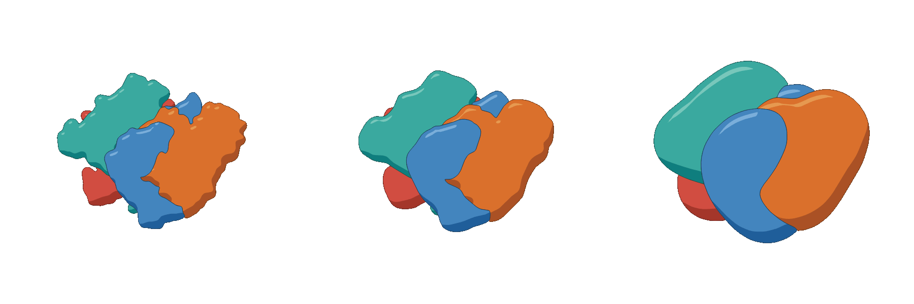

# Illustruct

Create smooth molecular silhouettes in ChimeraX. Export editable SVG/PDF or PNG.



## Install

Illustruct has been tested with ChimeraX 1.10 on Apple silicon Macs.

Download the latest `.whl` from
[GitHub Releases](https://github.com/leightonpayne/illustruct/releases). Run in
ChimeraX’s command line with its working folder set to the folder containing the
wheel:

```text
toolshed install illustruct-0.1.0-py3-none-any.whl
```

To update, install a newer wheel with the same command and restart ChimeraX.

To uninstall, run in ChimeraX’s command line and restart ChimeraX:

```text
toolshed uninstall illustruct
```

## Use

Run in ChimeraX’s command line:

```text
illustruct
```

The panel is also under **Tools → Depiction → Illustruct**.

See the [figure workflow](docs/usage.md) and
[command reference](docs/commands.md) for examples. For the bundled offline
guide, open the Illustruct panel’s context menu and choose **Help**.
