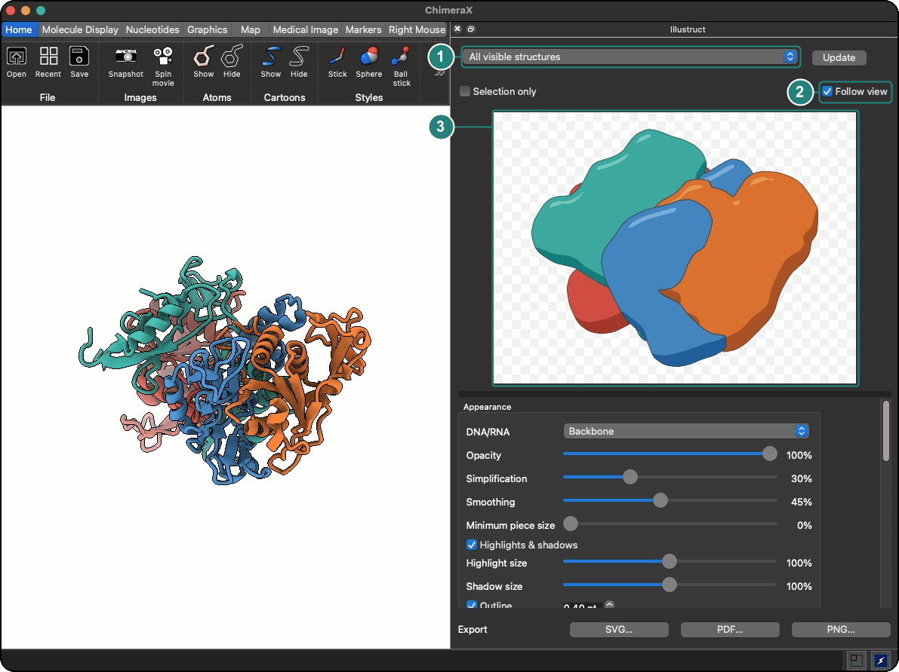
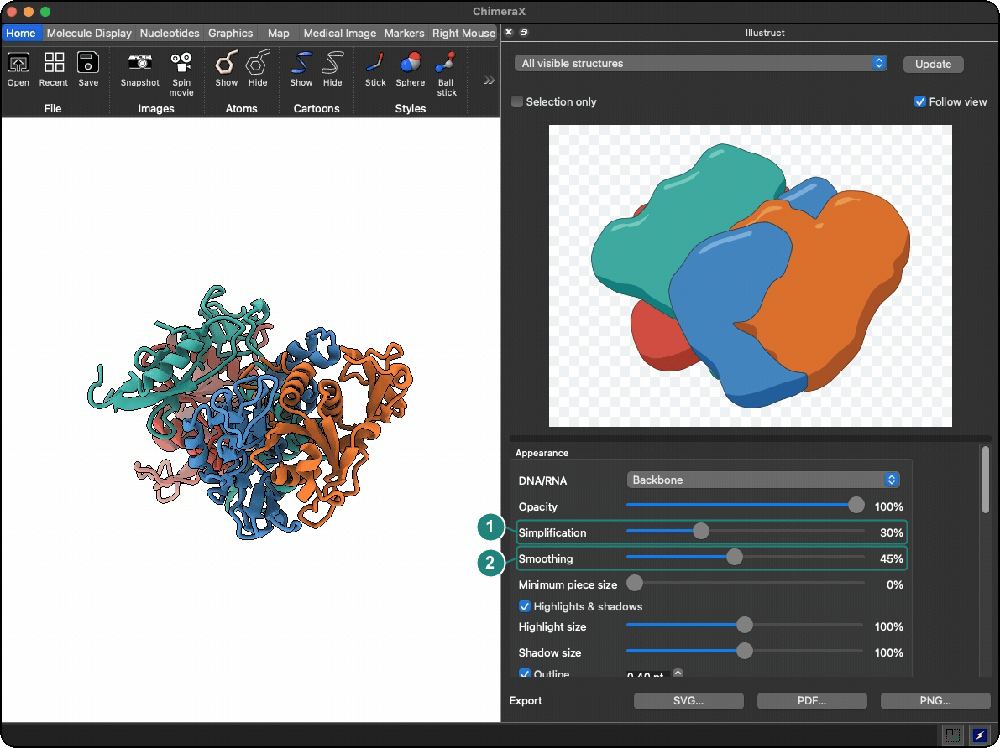
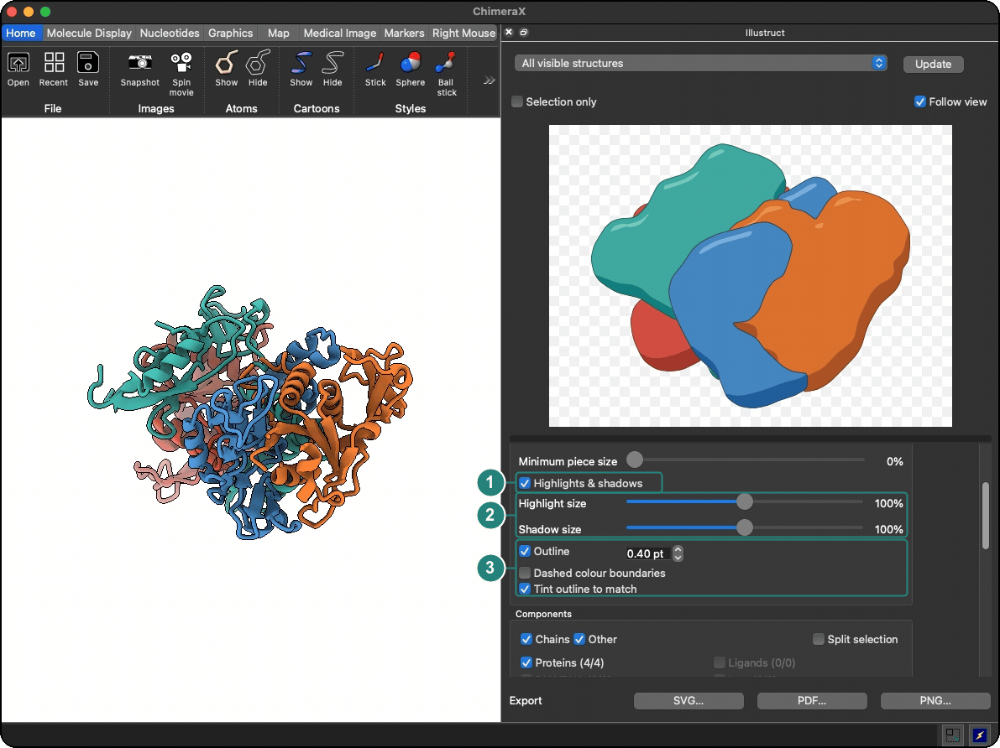
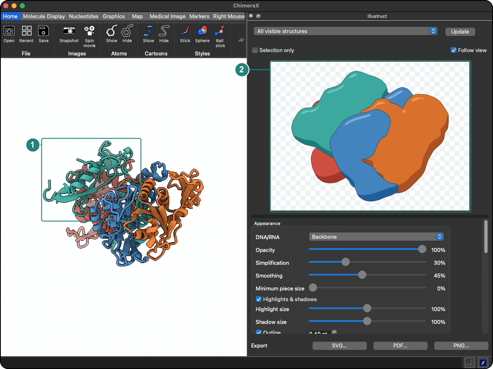
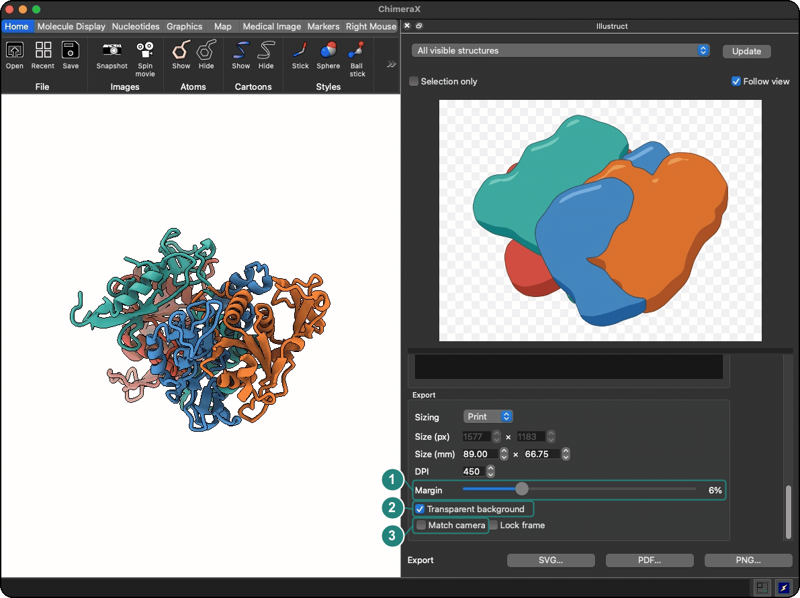

# Make a figure

Try these examples with [PDB **9B7D**](https://www.rcsb.org/structure/9B7D).
Illustruct uses the colors you set in ChimeraX. Click an animation to view it at
full size; numbers in parentheses refer to its callouts.

## 1. Open the structure and launch Illustruct

Run these commands in ChimeraX:

```text
open 9b7d
illustruct
```

Choose the model from the source menu **(1)**, or use **All visible
structures**. Rotate the view with **Follow view** **(2)** enabled and watch the
preview follow. You can also drag the preview **(3)** to rotate, or
**Shift-drag** to spin. **Update** refreshes the illustration when following is
paused. Closing a structure in the illustration refreshes the preview even when
following is paused.

[](assets/walkthrough/01-open.gif)

[Still image](assets/walkthrough/01-open.png)

## 2. Adjust the appearance

**Simplify the shape.** Increase **Simplification** **(1)** for broader shapes,
then vary **Smoothing** **(2)** to round their contours. Change one slider at a
time to see its effect.

[](assets/walkthrough/03-shape.gif)

[Still image](assets/walkthrough/03-shape.png)

**Compare lighting.** Turn **Highlights & shadows** **(1)** off for flat fills,
then turn it back on to restore the lighting. The **Highlight size** and
**Shadow size** sliders **(2)** adjust the size of those regions. The
**Outline** controls **(3)** set border visibility and width; **Tint outline to
match** follows each component’s color.

[](assets/walkthrough/04-lighting.gif)

[Still image](assets/walkthrough/04-lighting.png)

**Change transparency.** Lower **Opacity** **(1)** to see through overlapping
components, then restore it to **100%** for opaque fills.

[](assets/walkthrough/05-opacity.gif)

[Still image](assets/walkthrough/05-opacity.png)

**Minimum piece size** hides small disconnected fragments while preserving each
component’s largest piece. Backbones are unaffected.

## 3. Choose components and colors

**Set colors in ChimeraX.** Run `color #1/B #4385BE` to change Chain B **(1)**
in model #1. The preview **(2)** follows the change. Run `color #1/B #3AA99F` to
return to its original color in this example. Displayed ribbon colors take
priority; atom-only protein residues use their most common heavy-atom color.

[](assets/walkthrough/06-source-colors.gif)

[Still image](assets/walkthrough/06-source-colors.png)

Scroll to **Components** to control entries individually. Uncheck a chain to
omit it from the illustration; check it again to restore it. The type filter
changes the list, and **Show** or **Hide** applies to all listed entries.
Filtering alone does not change visibility.

**Illustrate a selection.** Select Chain B in ChimeraX—for model #1, run
`select #1/B`. Enable **Selection only** to show just that selection, then
disable it to return to the visible structures. Selected hidden atoms are
included too.

Different protein residue colors create components automatically. To separate
part of a chain while retaining the rest, select residues, leave Selection only
off, and enable **Split selection**. You can then hide the selected-residues
entry independently. **Dashed colour boundaries** marks borders between
differently colored regions of a protein chain when Outline is enabled.

New illustrations show **Proteins**. Enable **DNA/RNA**, **Ligands**, or
**Ions** for structures containing them. The **DNA/RNA** appearance menu offers
**Backbone** and **Silhouette**.

## 4. Export and save

Scroll to **Export**. Increase **Margin** **(1)** to add space around the
artwork. Enable **Match camera** **(3)** to use ChimeraX’s projection and
framing; this disables Margin. Turn it off to return to the fitted orthographic
view. Toggle **Transparent background** **(2)** to compare a white background
with transparency.

[](assets/walkthrough/08-framing.gif)

[Still image](assets/walkthrough/08-framing.png)

Choose **Print** for millimeters and DPI, or **Pixels** for exact image
dimensions. **Lock frame** preserves framing during rotation and can crop
components; Match camera takes precedence.

Once the preview finishes refining, export **SVG…** for editable component
groups, **PDF…** for vector artwork at its physical page size, or **PNG…** for a
raster image. Save a ChimeraX **`.cxs` session** to retain the structures and
illustration settings.

Download the example as [SVG](assets/9b7d.svg) or [PNG](assets/9b7d.png). See
[Commands](commands.md) for scripted exports.

## Representation limits

Illustruct produces stylized atomic envelopes. Surfaces, maps, labels, cartoon
thickness, and clipping planes are not reproduced. Water and hydrogen are
excluded. Strong simplification can close narrow openings; small details may
disappear.

Protein atom colors are reduced to one color per residue. DNA/RNA uses one
representative color per component. Backbones follow observed sugar anchors
without base tabs or inferred base pairs.
